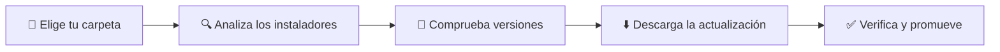
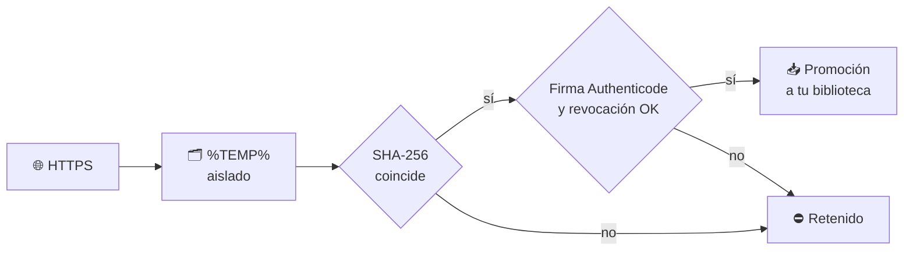

<div align="center">

# 📦 InstallerKeeper

### Mantén tu biblioteca de instaladores siempre al día

Organiza tu colección local de instaladores, consulta las versiones oficiales más recientes en **WinGet** y **GitHub Releases** y descarga las actualizaciones de forma segura.

[](https://www.microsoft.com/windows)
[](https://dotnet.microsoft.com)
[](https://github.com/elkekito/InstallerKeeper/releases/latest)
[](LICENSE)

[**⬇️ Descargar la última versión**](https://github.com/elkekito/InstallerKeeper/releases/latest)

</div>

> [!NOTE]
> InstallerKeeper administra exclusivamente **archivos instaladores**. Nunca los ejecuta ni instala, actualiza o desinstala software de tu sistema.

---

## ✨ Lo que puedes hacer

| | Función | Descripción |
|:---:|---|---|
| 📚 | **Biblioteca completa** | Detecta y analiza `EXE`, `MSI`, `MSIX`, `MSIXBundle`, `APPX`, `APPXBundle` y `ZIP`, con metadatos y arquitectura, sin ejecutar nada. |
| 🔎 | **Doble fuente** | Consulta **WinGet** y **GitHub Releases** en paralelo y resuelve la versión más reciente. |
| 🛡️ | **Descargas verificadas** | SHA-256, firma **Authenticode** y revocación online antes de promover cualquier archivo. |
| 🎛️ | **Interfaz moderna** | Vista en **Tabla** o **Tarjetas**, panel **Inspector** y temas Claro, Oscuro o del Sistema. |
| 🧹 | **Archivo `.Archive`** | Guarda versiones anteriores y purga las antiguas con retención configurable. |
| 📊 | **Exportación** | Catálogo en **CSV** (compatible con Excel), **JSON** o informe **HTML**. |
| ⚡ | **Arranque rápido** | Caché de análisis en disco: solo se vuelven a leer los archivos nuevos o modificados. |

---

## 🚀 Primeros pasos



1. **Elige la carpeta** de instaladores que quieres supervisar y si incluir subcarpetas.
2. **Confirma los paquetes** detectados con su identificador de WinGet o repositorio de GitHub.
3. **Haz clic en «Comprobar todas»** para consultar todas las aplicaciones en paralelo.
4. **Descarga** lo que tenga nueva versión. Solo se promueve lo que supera las comprobaciones.

---

## 🔒 Descargas seguras

Cada descarga pasa por un proceso de varias comprobaciones antes de llegar a tu biblioteca:



| Comprobación | Qué garantiza |
|---|---|
| **HTTPS** | Solo conexiones cifradas. |
| **SHA-256** | El archivo coincide con el hash oficial publicado. |
| **Authenticode** | Firma digital válida y cadena de certificados verificada. |
| **Revocación online** | Certificados revocados quedan descartados. |
| **Sin residuos** | La biblioteca nunca recibe carpetas auxiliares. |

### Políticas de promoción

| Política | Resultado |
|---|---|
| 🔁 **Reemplazar** | La nueva versión sustituye a la anterior. |
| 🗃️ **Archivar** | La versión anterior pasa a `.Archive`. |
| 📚 **Conservar todas** | La nueva versión se guarda con nombre único. |

Por defecto se pide confirmación antes de promover. En **Opciones** puedes activar la promoción automática de descargas verificadas o [ocultar los mensajes de descarga y promoción](#-opciones). En ambos casos, solo se promueve lo que supera las comprobaciones.

---

## 🌍 Proxy

Las descargas usan el **proxy configurado en Windows**. Con proxy, el proxy decide el destino final de la conexión, así que la comprobación de IP pública no cubre ese destino.

---

## ⚙️ Opciones

- **Promoción automática** de descargas verificadas (desactivada por defecto).
- **Ocultar mensajes** de descarga y promoción; los avisos se muestran en la barra de estado.
- **Temas** Claro, Oscuro o del Sistema y vistas Tabla o Tarjetas.

---

## 📋 Requisitos

| Requisito | Detalle |
|---|---|
| 🪟 **Sistema** | Windows 10 o Windows 11 (x64) |
| 📦 **WinGet** | Opcional. Solo hace falta para paquetes de WinGet. |
| 🧩 **.NET** | No hace falta instalarlo: el ejecutable es autocontenido. |
| 🔑 **GitHub** | Sin token, el límite es de 60 consultas por hora. |

---

## 🛠️ Compilar y publicar

Requiere el **SDK de .NET 10**. Desde la raíz del repositorio, en PowerShell:

```powershell
dotnet publish .\src\InstallerKeeper\InstallerKeeper.csproj --configuration Release -p:PublishProfile=WinX64 -p:PublishDir=..\..\artifacts\publish\1.1.6\win-x64\
```

El ejecutable queda en `artifacts\publish\1.1.6\win-x64\InstallerKeeper.exe`. Para publicar y mostrar su SHA-256 con el script de ayuda:

```powershell
.\scripts\Publish-InstallerKeeper.ps1
```

---

## 📄 Licencia

Distribuido bajo la licencia [MIT](LICENSE).

Componentes de terceros:
- [Licencias de .NET para Windows](https://github.com/dotnet/core/blob/main/license-information-windows.md)
- [Licencia de Bibliotecas de .NET](https://dotnet.microsoft.com/en-us/dotnet_library_license.htm)
- [Licencia del código fuente de WPF](https://github.com/dotnet/wpf/blob/main/LICENSE.TXT)
- [Licencia de Windows Package Manager CLI (WinGet)](https://github.com/microsoft/winget-cli/blob/master/LICENSE)

<div align="center">

---

Hecho con ❤️ para Windows

</div>
